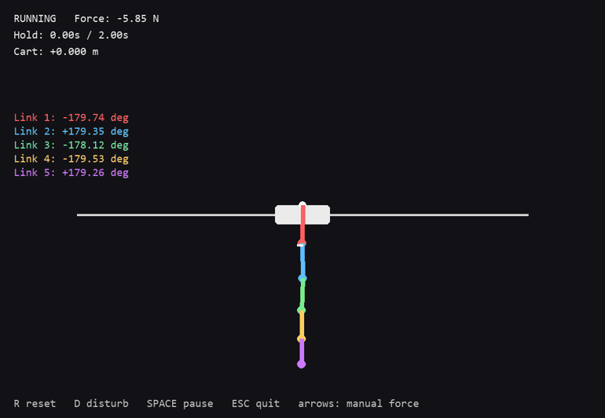

# Five-Link Inverted Pendulum

A Python simulation of a cart with five connected pendulums, controlled through imitation learning with PyTorch.



## Run

Requires Python 3.11+. With your Python environment activated:

```bash
pip install -r requirements.txt
python play.py
```

**R** reset · **D** disturb a joint · **Space** pause · **Esc** quit.
For manual control, run `python play.py --manual` and use the arrow keys.

## Results

PPO and a conventional imitation MLP were tried before using a structured imitation controller.

| Evaluation | Success |
| --- | --- |
| Standard physics step (0.005 s) | 512/512 |
| Finer physics step (0.0025 s) | 64/64 |

Success requires all five links within 10° of upright and below 0.5 rad/s for two seconds, with no track exit during the 15-second episode. The track extends ±2.4 m.

These tests use small random variations around a downward starting position. They do not demonstrate recovery after pressing **D**; larger disturbances can make the controller fail.

## How it works

The simulator models coupled cart/link dynamics and integrates motion with RK4. The controller selects one of eight demonstrated routes, uses a small neural network for each swing-up stage, then switches to a balance network. The networks have fixed ReLU hidden layers and learn their output weights from expert examples. Demonstration details are in [data/README.md](data/README.md).

## Train and evaluate

```bash
python train.py
python evaluate.py --episodes 512 --seed 91000
python evaluate.py --episodes 64 --seed 99000 --physics-step 0.0025
python -m unittest test_physics test_learning
```

`physics.py` contains the dynamics, `environment.py` the episode rules, and `model.py` the controller. `ppo.py` contains the separate PPO experiment.
